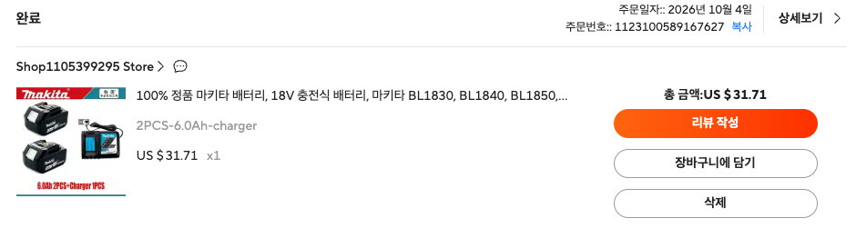

# 마키타 18V LXT 호환 리튬이온 배터리 기술 사양서
(Makita 18V LXT Compatible Li-ion Battery Technical Specification)

## 1. 개요 (Overview)
본 문서는 AliExpress에서 구매한 마키타(Makita) 18V LXT 호환 배터리 팩을 전원 소스로 활용하여 다양한 임베디드 및 하드웨어 응용 기기(Application)를 개발하기 위한 기술 사양 및 엔지니어링 가이드라인을 정의합니다.

### 1.1 구매 정보 (Order Details)



- **제품명**: 100% 정품 마키타 배터리, 18V 충전식 배터리, 마키타 BL1830, BL1840, BL1850, BL1860B 전동 공구 배터리 교체용
- **구매처 링크**: [AliExpress 상품 페이지 (Item ID: 1005013134957744)](https://ko.aliexpress.com/item/1005013134957744.html?spm=a2g0o.order_list.order_list_main.23.4803140fX5nOCd&tblci=GiCS9h0KKgkDTGY9im3LGsf1GfiWaDaM2M480C6x2QXXZiCnqXUorOThsf72yMPqATCCong&gatewayAdapt=glo2kor)
- **스토어**: Shop1105399295 Store
- **주문일자**: 2026년 10월 4일
- **주문번호**: `1123100589167627`
- **구매 옵션**: **2PCS-6.0Ah-charger** (6.0Ah 배터리 2개 + 충전기 1개 세트)
- **구매 가격**: US $31.71
- **호환 규격**: Makita 18V LXT 시스템 (BL1815, BL1830, BL1840, BL1850, BL1860B 계열)
- **문서 목적**: 전원 인출 핀아웃, 전압 및 방전 특성, BMS 보호 회로 동작 방식, DIY 응용 회로 설계 시 필수 요구사항 및 안전 가이드라인 수립

---

## 2. 전기적 사양 (Electrical Specifications)

| 항목 (Parameter) | 사양 (Specification) | 비고 (Remarks) |
| :--- | :--- | :--- |
| **배터리 화학 성분** | 리튬이온 (Li-ion, NMC 계열) | 원통형 18650 셀 기반 |
| **셀 구성 (Configuration)** | **5S2P** (5개 직렬 x 2개 병렬) | 총 10개 셀 내장 (5.0Ah/6.0Ah 기준) |
| **공칭 전압 (Nominal Voltage)** | **18.0 V** | 셀당 3.6V x 5S (또는 18.5V / 3.7V 기준) |
| **완충 전압 (Full Charge Voltage)** | **21.0 V** | 셀당 4.20V x 5S (CC/CV 충전 완료 시점) |
| **방전 종지 전압 (Cut-off Voltage)** | **14.0 V ~ 15.0 V** | 셀당 2.8V ~ 3.0V (15.0V 이하 방전 제한 권장) |
| **표기 정격 용량 (Nominal Capacity)** | 5.0 Ah / 6.0 Ah 옵션 | 셀당 2,500mAh 또는 3,000mAh (표기 스펙) |
| **실효 가용 용량 (Typical Usable)** | 약 3.5 Ah ~ 4.8 Ah | 알리익스프레스 호환 배터리 셀 실측치 고려 |
| **저장 에너지 (Stored Energy)** | 90 Wh (5.0Ah 기준) ~ 108 Wh (6.0Ah) | 항공 운송 기준(100Wh 이하) 유의 |
| **정격 연속 방전 전류 (Continuous)** | **15 A ~ 20 A** | 발열 및 셀 수명 고려 권장치 |
| **최대 피크 방전 전류 (Peak)** | **30 A ~ 40 A** | 10초 이내 모터 기동 부하 기준 |
| **충전 전압 / 표준 전류** | DC 21.0V ~ 21.5V / 2.0A ~ 4.0A | 정품 급속 충전기(DC18RC 등) 또는 전용 CC/CV |

> ⚠️ **주의사항 (Capacity Derating)**:  
> 중국산 호환 배터리의 경우 표기 용량(6.0Ah 등) 대비 실제 내장된 18650 셀의 실측 방전 용량은 약 70%~85% 수준(3.5~4.5Ah)일 수 있으므로, 런타임 계산 시 마진을 20% 이상 감안해야 합니다.

---

## 3. 기구 규격 및 외형 인터페이스 (Mechanical Form Factor)

```
       [ 래치 해제 버튼 (Push Latch) ]
                 │
  ┌──────────────┴──────────────┐
  │   [LED 잔량 표시창 & 버튼]   │   (전면부)
  │                             │
  ├─────────────────────────────┤
  │   [ - ]     [ TH ]    [ + ] │   (상단 메인 블레이드 단자 슬롯)
  │                             │
  │     [ Yellow Connector ]    │   (내부 디지털/밸런싱 커넥터)
  │    (Star Mark / Data Block) │
  └─────────────────────────────┘
                 │
        (공구 슬라이드 체결 방향)
```

- **외형 치수**: 약 115mm (길이) x 75mm (폭) x 65mm (높이)
- **중량**: 약 580g ~ 620g
- **체결 방식**: 슬라이드 온(Slide-on) 락킹 레일
  - 배터리 후면을 잡고 공구/마운트에 전방 방향으로 슬라이딩 체결
  - 분리 시 상단 전면의 래치 릴리즈 버튼(흰색/검은색 스프링 버튼)을 아래로 누른 채 후방으로 슬라이드 탈착
- **하우징 재질**: 내충격성 ABS/PC 엔지니어링 플라스틱
- **기구적 활용 방안**: 
  - 3D 프린터용 마키타 배터리 마운트 어댑터 STL(Thingiverse 등 오픈소스 배포 모델 다수) 사용 가능
  - 시중 "Makita 18V Battery Dock / Power Wheels Adapter" 완제품 활용 시 블레이드 단자와 12/14AWG 배선 및 퓨즈 홀더가 기본 장착되어 있어 프로젝트 적용이 용이함

---

## 4. 단자 핀아웃 및 전기적 인터페이스 (Terminal Pinout & Electrical Interface)

배터리 상단 단자부를 위에서 바라볼 때 (슬라이드 방향이 전면인 기준):

```
       [ 래치 해제 버튼 (Push Latch) ]
                 │
  ┌──────────────┴──────────────┐
  │   [LED 잔량 표시창 & 버튼]   │   (전면부)
  │                             │
  ├─────────────────────────────┤
  │   [ - ]     [ 3rd ]   [ + ] │   (상단 메인 블레이드 단자 슬롯)
  │ (GND 0V)   (Aux B+)  (Main B+)
  │                             │
  │  ┌───────────────────────┐  │
  │  │ [1] [2] [3] [4] [5] [6]│  │   (내부 디지털 옐로우 커넥터)
  │  └───────────────────────┘  │
  └─────────────────────────────┘
```

---

### 4.1 메인 블레이드 단자 (Primary Blade Terminals)

| 단자 명칭 | 물리적 위치 | 전압 레벨 (측정치) | 내부 연결 및 기능 설명 |
| :---: | :---: | :---: | :--- |
| **`+` (Main B+)** | 우측 슬롯 | **+18.0V ~ +21.0V** | **주 전원 양극 단자**. 대전류(15A~40A) 모터 구동 및 메인 충전 전류 경로. 굵은 버스바 직결. |
| **보조 단자 (3rd / Aux B+)**<br>*(구형 통칭: TH)* | 중앙 슬롯 | **+18.0V ~ +21.0V**<br>*(B+와 전압 동일)* | **PTC 보호 보조 B+ 전원 단자**. B+ 라인과 **약 1.2 Ω 파워 PPTC 소자**를 통해 연결됨. 공구 로직 전원 공급 및 쇼트 방지. |
| **`-` (Main B-)** | 좌측 슬롯 | **0V (GND)** | **주 전원 음극 단자 (Ground)**. 모터 대전류 및 회로 접지 복귀 경로. |

#### 🔍 보조 단자(3rd Blade)의 심층 분석 및 실측 데이터 검증
- **실측 저항 데이터**: 메인 `+` 단자와 보조 단자 간 저항 측정 시 **약 1.2 Ω** 검출.
- **1mV 오차 없는 전압 일치 원리 (수학적 검증)**:
  - 디지털 멀티미터(DMM)의 전압 측정 모드는 내부 입력 임피던스가 **$10\text{ M}\Omega$ ($10,000,000\ \Omega$)**로 매우 높습니다.
  - 1.2 Ω PTC를 거쳐 멀티미터로 흐르는 전류는 약 $2\ \mu\text{A}$ ($19.987\text{V} / 10\text{M}\Omega$)에 불과합니다.
  - 이에 따라 1.2 Ω 양단에서 발생하는 전압 강하는 $\Delta V = 2\ \mu\text{A} \times 1.2\ \Omega \approx \mathbf{0.0024\text{ mV}}$로 실질적으로 0에 수렴하므로, `+` 단자 전압(19.987V)이 1mV 오차 없이 완벽히 동일하게 측정됩니다.
- **정확한 용도 및 설계 목적**:
  1. **공구 내부 제어 로직(MCU/LED/스위치) 전원 공급**: 대전류 모터 라인과 분리하여 공구 내부 제어 기판에 안정적인 전원 공급.
  2. **파워 PPTC(Polymeric PTC)를 통한 화재/단락 방지**: 공구 내부 스위치나 LED 배선 쇼트 시 1.2 Ω PPTC가 자체 발열하여 고저항(Trip) 상태로 전환, 배터리 화재를 차단하고 정상화 시 자동 복귀.
  3. **스타 프로텍션(Star Protection) 인터록**: 공구 본체에 "배터리 전압이 정상적으로 결합됨"을 알리는 인에이블 신호선 역할.
- **💡 DIY 개발 활용 팁**: 소전류(아두이노 MCU, 센서, LED 등)는 이 보조 단자를 `+`로 사용하면 자체 1.2Ω 퓨즈 보호 효과를 얻을 수 있으며, 대전류 부하는 반드시 메인 `+` 단자를 사용해야 합니다.

---

### 4.2 내부 옐로우 커넥터 (Yellow Multi-Pin Connector Block)

배터리 상단 안쪽에 위치한 노란색 사출 플라스틱 하우징의 **2.54mm 피치 다핀(7~8핀) 커넥터**는 공구 사용 중에는 연결되지 않고, **마키타 순정 급속 충전기(DC18RC 등) 및 진단 장비(BTC04)와 도킹할 때만 결합되는 디지털 통신 포트**입니다.

```
          [ 노란색 커넥터 핀 배열 (Top View) ]
        ┌───────────────────────────────────┐
        │  [1]   [2]   [3]   [4]   [5]   [6]│  (배터리 상단 안쪽)
        └───────────────────────────────────┘
         (배터리 - 단자 쪽)               (배터리 + 단자 쪽)
```

#### 📌 노란색 커넥터 상세 핀아웃 (배터리 '-' 단자 쪽부터 Pin 1 기준)

| 핀 번호 | 신호 명칭 (Signal) | 논리 레벨 / 인터페이스 | 상세 기능 및 역할 |
| :---: | :--- | :--- | :--- |
| **Pin 1** | **NC (Reserved)** | - | 미연결 또는 내부 예약 핀 |
| **Pin 2** | **1-Wire DATA** | 양방향 디지털 시리얼 | **마키타 독점 1-Wire 시리얼 통신 데이터 라인**.<br>외부 4.7kΩ 풀업 저항(3.3V/5V)을 통해 충전기와 패킷 교환. |
| **Pin 3** | **Internal / NC** | - | 세대별 내부 셀 탭 또는 미사용 |
| **Pin 4** | **GND / Sense** | 0V (B-) | 센싱 및 신호용 접지 기준선 |
| **Pin 5** | **NTC / Temp** | 아날로그 센서 신호 | 내부 셀 밀착 정밀 NTC 서미스터 온도 감지 라인 |
| **Pin 6** | **ENABLE (Wake-Up)** | 3.3V Active-High | **BMS 통신 활성화(Wake-up) 핀**.<br>이 핀에 3.3V High 신호를 인가해야 내부 MCU가 슬립에서 깨어나 Pin 2로 응답함. |
| **Pin 7~8**| **V+ / Guide** | + 전원 또는 가이드 | 하우징 고정 및 전원 참조 핀 |

#### 📡 전송 데이터 및 핵심 제어 기능
1. **개별 셀 전압 텔레메트리**: 5개 직렬 셀(Cell 1~5)의 개별 전압을 정밀 수신하여 밸런스 상태 감시.
2. **배터리 수명 및 충전 사이클 카운터(Cycle Count)**: 누적 충전 횟수 및 사용 이력 관리.
3. **정밀 온도 감지 및 충전 제어**: 내부 NTC 온도를 읽어 충전기 쿨링팬 속도 조절 및 과열 시 충전 전류 동적 감발/차단.
4. **BMS 영구 락(Lock) 플래그 관리**: 3회 이상 비정상 충전 시 충전 거부 락(Lock)을 걸어 안전 확보 (오픈소스 OBI 프로젝트를 통해 락 해제 및 진단 가능).

---

## 5. 내장 BMS 및 안전 회로 분석 (BMS & Safety Features)

본 알리익스프레스 호환 배터리 내부 BMS 보드는 다음과 같은 보호 회로를 내장하고 있습니다:

1. **과충전 보호 (Overcharge Protection - OVP)**:
   - 셀 전압이 4.25V ± 0.05V 도달 시 충전 차단
2. **과방전 보호 (Over-discharge Protection - UVP)**:
   - 셀 전압이 2.7V ~ 2.8V 도달 시 차단 신호 발생
3. **과전류 및 단락 보호 (Overcurrent / Short Circuit Protection - OCP/SCP)**:
   - 출력 단락(쇼트) 또는 정격 초과 전류(>40A) 발생 시 퓨즈 또는 MOSFET 트립
4. **셀 밸런싱 회로 (Cell Balancing)**:
   - 수동 저항 방전 방식(Passive Bleeding)으로 충전 말기 각 셀 간 편차 보정
5. **온도 모니터링 (Thermal Cut-off)**:
   - 팩 내부 NTC 서미스터를 통해 65℃~70℃ 초과 시 충전/방전 보호 동작

### ⚠️ 중요: 응용 어플리케이션 개발 시 치명적 주의점 (Must Read!)

> [!CAUTION]
> **마키타 시스템의 과방전 보호 구조 및 호환 배터리의 한계**:
> 1. **공구 측 차단 방식**: 마키타 정품 공구 시스템은 과방전 차단 로직(Low Voltage Cutoff)이 **공구 본체의 컨트롤러**에 구현되어 있습니다. 따라서 배터리 내부의 `+`/`-` 메인 단자는 내부 저항을 줄이기 위해 배터리 팩에 **상시 직결(Direct Pass-through)**되어 있거나 방전 FET 저항이 매우 작습니다.
> 2. **호환 배터리의 과방전 방치 위험**: 알리익스프레스 호환 배터리의 상당수는 DIY 기기에서 전원을 계속 끌어다 쓸 경우, 배터리 BMS가 방전 전류를 물리적으로 완전히 차단하지 못하고 **0V 근처까지 방전(과방전/벽돌화)**될 위험이 큽니다.
> 3. **해결책**: 배터리를 사용하는 외부 어플리케이션 회로 쪽에 **반드시 독립적인 저전압 차단 장치(LVD, Low Voltage Disconnect)를 필수 설치**해야 합니다! (권장 컷오프 전압: **15.0V**)

---

## 6. LED 잔량 표시계 동작 사양 (LED Indicator)

배터리 전면 푸시 버튼을 누르면 4개의 녹색(또는 적색) LED가 켜지며 잔량을 표시합니다.

| LED 점등 상태 | 배터리 잔량 (State of Charge) | 배터리 전압 범위 (5S 기준) |
| :---: | :---: | :---: |
| ● ● ● ● (4개 점등) | **75% ~ 100%** | 약 19.8V ~ 21.0V |
| ● ● ● ○ (3개 점등) | **50% ~ 75%** | 약 18.8V ~ 19.8V |
| ● ● ○ ○ (2개 점등) | **25% ~ 50%** | 약 17.8V ~ 18.8V |
| ● ○ ○ ○ (1개 점등) | **10% ~ 25%** | 약 16.5V ~ 17.8V |
| ○ ○ ○ ○ (점멸/소등) | **10% 미만 (충전 필요)** | 16.0V 이하 (즉시 재충전 필요) |

---

## 7. 어플리케이션 개발 시 하드웨어 설계 권장 구성

마키타 배터리를 이동형/독립형 전원 공급기로 변환하는 시스템 블록 다이어그램:

```
[ 마키타 18V 배터리 ] (15V ~ 21V)
        │
        ├── [ 자동차용 인라인 퓨즈 (20A~30A Blade Fuse) ] ── (필수: 단락 및 화재 방지)
        │
        ├── [ 메인 토글 전원 스위치 ]
        │
        ├── [ 저전압 차단 모듈 (LVD, XH-M609 등, 15.0V 설정) ] ── (필수: 배터리 수명 보호)
        │
        └── [ 전력 변환 모듈 (어플리케이션 목적에 따라 선택) ]
                │
                ├── ① 12V Buck Converter (예: XL4016, 8A~10A) ──> 차량용 기기, 12V LED, 라우터
                │
                ├── ② USB-PD 65W/100W 모듈 (IP2368 / SW3518) ──> 노트북, 스마트폰 급속 충전
                │
                ├── ③ DC 모터 속도 제어기 (PWM Driver) ──> 펌프, 팬, 전동 카트, 리니어 액추에이터
                │
                └── ④ 순수정현파 인버터 (18V/24V to AC 220V) ──> 야외 휴대용 파워뱅크
```

### 7.1 권장 부품 및 규격

1. **배터리 마운트 어댑터 (Dock)**:
   - 마키타 18V 슬라이드 브래킷 (12AWG 또는 14AWG 실리콘 전선 인출형)
2. **안전 퓨즈 (Safety Fuse)**:
   - 스텝다운/USB-PD 용도: **15A ~ 20A** 블레이드 퓨즈
   - 고출력 모터/인버터 용도: **30A** 블레이드 퓨즈
3. **저전압 차단(LVD) 모듈**:
   - 기성 모듈: `XH-M609` (전압 디지털 설정 가능, 15.0V 이하 릴레이 OFF)
   - 자체 MCU 설계 시: 분압 저항(Voltage Divider)을 통해 ADC 핀으로 입력 감시 후 High-side P-Ch MOSFET 또는 N-Ch 로우사이드 스위치 제어
4. **배선 규격 (Wire Gauge)**:
   - 10A 이하 지속 부하: 16 AWG
   - 15A ~ 20A 부하: 14 AWG 실리콘 전선
   - 25A 이상 피크 부하: 12 AWG 실리콘 전선

---

## 8. 충전 가이드라인 (Charging Guidelines)

1. **마키타 순정/호환 슬라이드 독 충전기 사용 (권장)**:
   - 모델: `DC18RC`, `DC18RD`, `DC18SD`, `DC18RF`
   - 충전 전압: 21V CC/CV
   - 옐로우 커넥터 핀과 연동되어 각 셀 밸런싱 및 충전 완료 후 멜로디/비프 알림 작동
2. **일반 DC 잭 또는 CC/CV 파워서플라이를 통한 충전**:
   - 충전 전압 제한: **최대 21.0V** (절대 21.5V 초과 금지)
   - 충전 전류 제한: 2.0A ~ 3.0A (배터리 수명 및 발열 억제를 위한 안전 충전율 0.5C 권장)
   - 만충 차단 전류: 0.1A ~ 0.2A 도달 시 충전 종료

---

## 9. 보관 및 취급 수칙 (Storage & Maintenance)

- **장기 보관 전압**: 3.7V ~ 3.8V/cell (팩 전체 기준 **약 18.5V ~ 19.0V** 수준에서 보관)
- **보관 온도**: 10℃ ~ 25℃ 건조한 장소 (직사광선 및 영하 온도 회피)
- **점검 주기**: 3~6개월 미사용 시 전압 체크 후 50% 수준으로 보충전 권장
- **폐기 절차**: 완전 방전 후 리튬 배터리 전용 수거함 배출

## 10. 관련 자료 및 레퍼런스 링크 (References & Search Links)

- **마키타 공식 스타 프로텍션 시스템 소개**:
  - [Makita Star Protection Computer Controls™ Official Overview](https://www.makitatools.com/products/details/BL1850B)
- **오픈소스 마키타 LXT 통신 프로토콜 리버스 엔지니어링**:
  - [GitHub: rosvall/makita-lxt-protocol (1-Wire 통신 프로토콜 및 8핀 노란색 커넥터 핀아웃 문서)](https://github.com/rosvall/makita-lxt-protocol)
  - [GitHub: mnh-jansson/open-battery-information (Martin Jansson의 OBI 공식 원본 프로젝트)](https://github.com/mnh-jansson/open-battery-information)
  - [GitHub: TheRepairforge/PocketOBI (ESP32-C3 기반 휴대용 마키타 배터리 진단 및 락 해제 기기 소스코드)](https://github.com/TheRepairforge/PocketOBI)
  - [GitHub: drakosha/makita-battery-tools (마키타 1-Wire 타이밍 및 통신 라이브러리)](https://github.com/drakosha/makita-battery-tools)
- **마키타 배터리 텔레메트리 진단 및 락(Lock) 해제 프로젝트 가이드**:
  - [Done.land: PocketOBI (하드웨어 결선도, 부품 목록 및 펌웨어 업로드 가이드)](https://done.land/tools/power/makita/battery/pocketobi/)
- **EEVblog 커뮤니티 하드웨어 분석**:
  - [EEVblog: Makita 18V Battery BMS Teardown and Communication Protocol](https://www.eevblog.com/forum/projects/makita-18v-lxt-battery-protocol/)
- **마키타 전동공구 및 배터리 시스템 특허 (USPTO)**:
  - [US Patent US11148272B2: Power Tool and Battery Pack System](https://patents.google.com/patent/US11148272B2/en)
  - [US Patent US20150035488A1: Battery Pack and Charging System](https://patents.google.com/patent/US20150035488A1/en)

---

## 11. 문서 개정 이력 (Revision History)

| 버전 (Version) | 개정 일시 (Date/Time) | 주요 개정 내용 및 변경 사유 |
| :---: | :---: | :--- |
| **v1.3** | 2026-10-24 12:07 | • 제10절 외부 오픈소스 레퍼런스 링크 팩트체크 및 404 에러 주소 교체<br>• 실제 라이브 GitHub URL(`mnh-jansson/open-battery-information`, `rosvall/makita-lxt-protocol` 등) 검증 및 링크 갱신 |
| **v1.2** | 2026-10-24 12:03 | • 사용자 실측 저항(1.2 Ω) 데이터를 바탕으로 제4.1절 보조 단자 규격 전면 개정 (1.2Ω 파워 PPTC 보호 보조 B+ 전원 및 0.0024mV 전압 강하 원리 수식화)<br>• 제4.2절 노란색 1-Wire 디지털 시리얼 통신 커넥터 상세 핀아웃(Pin 1~8) 및 텔레메트리 규격 추가<br>• 제10절 전문 기술 레퍼런스 및 특허 링크 신설 |
| **v1.1** | 2026-10-24 11:34 | • 제1.1절 '구매 정보 (Order Details)' 섹션 추가<br>• AliExpress 실제 배터리 구매 내역 캡처 이미지(`docs/images/261024_aliexpress_order_makita_battery.png`) 및 구매 옵션(`2PCS-6.0Ah-charger`, $31.71) 반영 |
| **v1.0** | 2026-10-24 10:22 | • 마키타 18V LXT 호환 리튬이온 배터리 상세 기술 사양서 최초 작성<br>• 기본 전기적 사양(5S2P 18V/21V/15V), 기구 폼팩터, 단자 기본 핀아웃, LVD 15V 보호 회로 필수 요구사항 정의 |


