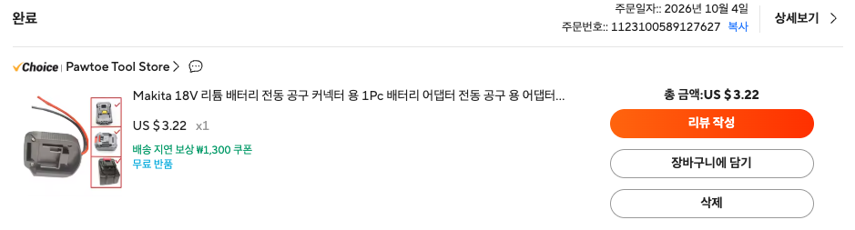

# 마키타 18V 배터리 DIY 전원 인출 도크 어댑터 기술 사양서
(Makita 18V LXT Battery Power Dock Adapter Technical Specification)

## 1. 개요 (Overview)
본 문서는 AliExpress에서 구매한 마키타(Makita) 18V LXT 슬라이드 배터리 장착용 **전원 인출 도크 어댑터(Power Wheels Adapter / Battery Connector Dock)**의 기구적/전기적 특성을 분석하고, 이를 주 전원 인터페이스로 활용하여 다양한 DIY 하드웨어 및 임베디드 응용 프로젝트를 안전하게 구현하기 위한 엔지니어링 사양서입니다.

### 1.1 구매 정보 (Order Details)



- **제품명**: Makita 18V 리튬 배터리 전동 공구 커넥터 용 1Pc 배터리 어댑터 전동 공구 용 어댑터 도크 홀더 BL1830 BL1840
- **구매처 링크**: [AliExpress 상품 페이지 (Item ID: 1005009306461029)](https://ko.aliexpress.com/item/1005009306461029.html)
- **스토어**: Pawtoe Tool Store (Choice)
- **주문일자**: 2026년 10월 4일
- **주문번호**: `1123100589127627`
- **구매 수량**: 1개
- **구매 가격**: US $3.22 (무료 배송)
- **호환 규격**: Makita 18V LXT 슬라이드 배터리 전 기종 (BL1815, BL1830, BL1840, BL1850, BL1860B 및 호환 팩)

---

## 2. 하드웨어 외형 및 기구적 사양 (Mechanical Specifications)

```
              [ 상단 슬라이드 결합 레일 ]
       ┌─────────────────────────────────────┐
       │     [ - ]                 [ + ]     │  (배터리 슬라이드 체결 방향)
       │    (Black)                (Red)     │
       │                                     │
       │  ┌───┐                         ┌───┐│
       │  │ O │ (Mounting Hole 1)       │ O ││ (Mounting Hole 2)
       │  └───┘                         └───┘│
       │                                     │
       │  ┌───┐                         ┌───┐│
       │  │ O │ (Mounting Hole 3)       │ O ││ (Mounting Hole 4)
       │  └───┘                         └───┘│
       └──────────────────┬──────────────────┘
                          │
             [ 붉은색(+) / 검은색(-) 리드선 인출 ]
```

### 2.1 치수 및 물리적 특성
- **외형 치수**: 약 90mm (길이) x 70mm (폭) x 25mm (두께)
- **장착 나사 홀 간격 (Mounting Hole Pitch)**: 
  - 세로 간격: **39.3 mm**
  - 가로 간격: **31.0 mm**
  - 보조 가로 간격: **25.0 mm**
  - 나사 구멍 규격: 직경 약 3.5mm ~ 4.0mm 카운터싱크(Countersunk) 홀 (M3/M3.5 접시머리 볼트 체결 적합)
- **중량**: 약 45g ~ 55g
- **하우징 재질**: 사출 성형 내열성 ABS/PC 엔지니어링 플라스틱
- **배터리 고정 방식**:
  - 배터리 상단 레일에 슬라이딩 방식으로 견고하게 밀착 체결
  - 배터리 본체의 스프링 락 래치(Push Latch)에 걸려 역방향 탈락 방지

---

## 3. 전기적 사양 및 배선 규격 (Electrical Specifications)

| 항목 (Parameter) | 사양 (Specification) | 비고 (Remarks) |
| :--- | :--- | :--- |
| **입력 / 출력 전압** | **DC 18.0V ~ 21.0V** | 배터리 단자 전압 직결(Direct Pass-through) |
| **방전 종지 전압 (컷오프)** | **14.0V ~ 15.0V** | **어댑터 자체 차단 회로 없음! (외부 LVD 필수)** |
| **배선 규격 (Wire Gauge)** | **14 AWG** (또는 12 AWG 고내열 연선) | UL 규격 고내열 실리콘/PVC 절연 전선 |
| **전선 길이** | 약 **130mm ~ 150mm** | 단자 끝단 스트립 처리 완료 |
| **극성 (Polarity)** | **붉은색(Red): `+` (Main B+)**<br>**검은색(Black): `-` (Main B-)** | 역극성 연결 시 회로 즉시 소손 주의 |
| **단자 재질 (Terminal Blade)** | 니켈 도금 인청동 / 황동 합금 판재 | 두께 0.8mm 내외, 대전류 접촉 최적화 |
| **정격 연속 허용 전류** | **15 A ~ 20 A** | 배선 및 단자 발열 고려 연속 사용 한계 |
| **최대 피크 방전 전류** | **30 A ~ 40 A** | 10초 이내 순간 기동 부하 기준 |
| **접촉 저항 (Contact Resistance)** | $\le 10\text{ m}\Omega$ | 단자 블레이드와 배터리 간 접촉 저항 |

---

## 4. ⚠️ 필수 하드웨어 안전 수칙 및 엔지니어링 위험 분석 (Critical Safety)

본 어댑터는 스위치, 퓨즈, 전압 감시 회로가 일절 포함되지 않은 **단순 기구물 기반의 물리적 직결(Direct Bypass) 커넥터**입니다. 따라서 안전장치 없이 부하에 직결할 경우 심각한 화재 및 배터리 영구 파손이 발생할 수 있습니다.

```
[안전 보호 회로가 구성된 표준 권장 결선도]

┌──────────────────┐
│  마키타 18V 배터리  │
└────────┬─────────┘
         │
┌────────┴─────────┐
│ DIY 도크 어댑터   │
└────────┬─────────┘
         │
         ├───[ + 라인 ] ───▶ [ 20A 인라인 블레이드 퓨즈 ] ───▶ [ 전원 토글 스위치 ]
         │                                                            │
         │                                                            ▼
         │                                               ┌────────────────────────┐
         │                                               │ 15.0V 저전압 차단(LVD) │
         │                                               │ (XH-M609 / 릴레이/FET) │
         │                                               └───────────┬────────────┘
         │                                                           │
         └───[ - 라인 ] ─────────────────────────────────────────────┴────▶ [ 부하 기기 (Load) ]
```

### 4.1 위험 요소 1: 과방전(Over-discharge)으로 인한 배터리 영구 사망
- **문제점**:
  - 마키타 순정 공구는 공구 본체의 제어 기판이 배터리 전압을 감시하여 15.0V 이하로 떨어지면 작동을 중단시킵니다.
  - 하지만 AliExpress 호환 배터리 및 본 도크 어댑터는 **과방전 차단 로직(LVD)이 전혀 없습니다.**
  - 부하(LED, 인버터, 모터)를 켜둔 채 방치하면 배터리 전압이 **10V, 5V, 심지어 0V까지 방전**되어 리튬이온 셀의 내부 화학 구조가 붕괴(내부 단락 및 동박 용해)되어 재충전이 불가능해집니다.
- **필수 대책**:
  - 부하 전단에 **반드시 15.0V 독립 저전압 차단 모듈(LVD Module: 예: XH-M609, HCW-M635)** 또는 저전압 차단 기능이 내장된 강압 컨버터를 설치해야 합니다.

### 4.2 위험 요소 2: 단락(쇼트) 시 대전류 화재 위험
- **문제점**:
  - 리튬이온 배터리는 내부 저항이 수십 $\text{m}\Omega$ 수준으로 매우 낮아, 인출선 양단이 쇼트되면 순간 **100A 이상의 폭발적인 단락 전류**가 흐릅니다.
  - 14AWG 전선 피복이 2초 만에 녹아내리고 불이 붙으며, 배터리 셀이 열폭주(Thermal Runaway)할 수 있습니다.
- **필수 대책**:
  - 붉은색(+) 전선 바로 뒤에 **15A ~ 20A 규격의 자동차용 인라인 방수 블레이드 퓨즈 홀더(Blade Fuse)**를 필수로 직렬 연결해야 합니다.

### 4.3 위험 요소 3: 역방향 충전(Charge-back) 금지
- 본 어댑터는 **방전(Output) 전용 커넥터**입니다.
- 이 어댑터의 전선을 통해 외부 충전기로 배터리를 충전할 경우 셀 밸런싱 모니터링이 되지 않아 셀 과충전 폭발 위험이 있으므로, 충전은 반드시 전용 슬라이드 충전기 포트(DC18RC 등)를 통해 수행해야 합니다.

---

## 5. DIY 응용 어플리케이션 활용 방안 (Project Applications)

본 도크 어댑터는 배터리의 강력한 방전 성능을 직접 뽑아낼 수 있어 다음과 같은 다양한 하드웨어 프로젝트의 메인 전원 베이스로 활용됩니다.

### 5.1 고출력 USB-PD 파워뱅크 (65W ~ 100W 노트북 충전 스테이션)
- **구성**: 도크 어댑터 ➡️ 20A 퓨즈 ➡️ LVD(15.0V 차단) ➡️ **IP6518 / SW3518S 기반 Buck-Boost USB-PD 모듈**
- **장점**: 야외, 현장, 캠핑장에서 스마트폰 초고속 충전뿐만 아니라 맥북/노트북 65W~100W PD 고속 충전 지원.

### 5.2 차량용 / 캠핑용 12V 10A 대전류 전원 공급기
- **구성**: 도크 어댑터 ➡️ 15A 퓨즈 ➡️ LVD ➡️ **DC-DC 18V-to-12V 10A 강압(Buck) 컨버터** ➡️ 시거잭 소켓
- **활용**: 차량용 냉장고(캠핑 쿨러), 12V 에어 펌프, 12V 캠핑 온열 매트 등 구동.

### 5.3 어린이 전동 승용 완구(Power Wheels) 파워 튜닝
- **구성**: 기존 무겁고 충전 느린 12V 납축전지를 제거하고, 본 마키타 도크 어댑터 장착 (PWM 모터 속도 제어기 + 30A 퓨즈 병행).
- **장점**: 주행 파워 대폭 향상, 빠른 배터리 탈착 교체 가능.

### 5.4 휴대용 고휘도 현장 작업등 / 서치라이트
- **구성**: 도크 어댑터 ➡️ 스위치 ➡️ **10W~30W 18V LED 서치라이트 헤드**를 일체형으로 마운팅 홀에 볼트 결합.
- **장점**: 현장 휴대용 강력 작업등 제작 가능.

---

## 6. 결선 및 제작 체크리스트 (Assembly Checklist)

| 단계 | 작업 항목 | 점검 기준 |
| :---: | :--- | :--- |
| **1단계** | **극성 확인** | 멀티미터로 붉은선(`+18~21V`), 검은선(`GND 0V`) 확인 |
| **2단계** | **퓨즈 결합** | 붉은색(+) 배선에 15A~20A 인라인 블레이드 퓨즈 직렬 납땜 |
| **3단계** | **스위치 추가** | 전원 대기 전력 소모를 차단하기 위한 락 스위치(10A 이상) 설치 |
| **4단계** | **LVD 모듈 세팅** | 저전압 차단 모듈 컷오프 전압을 **15.0V**로 설정 (복귀 16.0V) |
| **5단계** | **절연 및 케이스** | 열수축 튜브 및 실리콘 절연 처리, 마운팅 홀 볼트 체결 고정 |

---

## 개정 이력 (Revision History)

| 버전 (Version) | 개정 일시 (Date & Time) | 개정 상세 내용 (Description of Changes) | 작성자 (Author) |
| :---: | :---: | :--- | :---: |
| **v1.0** | 2026-10-24 12:38 | 마키타 18V 배터리 DIY 전원 인출 도크 어댑터 기술 사양서 초안 제정 (구매 정보, 기구 치수, 전기 사양, 15V LVD 및 20A 퓨즈 필수 안전 가이드라인 수립) | AI Assistant |
