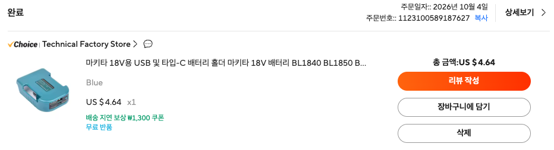

# 마키타 18V 배터리용 USB & Type-C 충전 어댑터 기술 사양서
(Makita 18V Battery to USB & Type-C Two-Way Power Source Adapter Technical Specification)

## 1. 구매 정보 및 제품 개요 (Order & Product Overview)

본 문서는 마키타(Makita) 18V LXT 호환 배터리를 다목적 휴대용 파워뱅크 및 비상 전원 공급 장치로 활용하기 위해 구매한 **USB & Type-C 양방향 충방전 어댑터 홀더**의 기술 사양, 내부 기능, 동작 특성 및 프로젝트 응용 가이드라인을 정의합니다.

### 1.1 구매 정보



- **제품명**: 마키타 18V용 USB 및 타입-C 배터리 홀더 / 충전 어댑터 (Makita 18V Battery USB & Type-C Power Source Adapter)
- **구매처 링크**: [AliExpress 상품 페이지 (Item ID: 1005006846372297)](https://ko.aliexpress.com/item/1005006846372297.html?spm=a2g0o.order_list.order_list_main.29.4803140fX5nOCd&tblci=GiCS9h0KKgkDTGY9im3LGsf1GfiWaDaM2M480C6x2QXXZiCnqXUorOThsf72yMPqATCCong&gatewayAdapt=glo2kor)
- **스토어**: Technical Factory Store (AliExpress Choice)
- **주문일자**: 2026년 10월 4일
- **주문번호**: `1123100589187627`
- **구매 가격**: US $4.64 (무료 반품 및 배송 보장 옵션)
- **색상 옵션**: Blue (마키타 시그니처 틸 블루 컬러)

---

## 2. 제품 외형 및 인터페이스 구조 (Hardware & Interface)

```
        ┌───────────────────────────────────┐
        │  [ Makita 18V Slide-on Mount ]    │ (하단: 배터리 슬라이드 체결 레일)
        ├───────────────────────────────────┤
        │                                   │
        │  [Power Button]   [LED Indicator] │ (상단 조작부: 원터치 전원 버튼 & 상태 LED)
        │                                   │
        │   ┌───────────┐   ┌───────────┐   │
        │   │  USB-A    │   │  Type-C   │   │ (전면 출력/입력 포트)
        │   │ (Output)  │   │(In/Output)│   │
        │   └───────────┘   └───────────┘   │
        └───────────────────────────────────┘
        │          [ Metal Belt Clip ]      │ (후면: 휴대용 메탈 벨트 클립)
```

- **슬라이드 체결부**: 마키타 18V LXT 규격 배터리 상단 홈에 완전히 결합되는 정밀 가이드 레일
- **전면 포트 구성**:
  - **USB-A 포트**: 표준 5V 출력 (스마트폰, 태블릿, 소형 기기 충전)
  - **Type-C 포트**: 양방향(Bidirectional) 지원 (출력 및 배터리 재충전 입력 겸용)
- **조작 버튼**: 원터치 푸시 버튼 (전원 출력 ON/OFF 제어)
- **상태 표시등**: 듀얼 컬러 LED (적색 / 녹색)
- **후면 기구**: 스테인리스 스틸 벨트 클립 (작업 벨트, 배낭 스트랩, 벽면 걸이 장착 가능)

---

## 3. 전기적 및 기계적 상세 사양 (Technical Specifications)

| 항목 (Parameter) | 상세 사양 (Specification) | 비고 (Remarks) |
| :--- | :--- | :--- |
| **호환 배터리 제품군** | 마키타 14.4V ~ 18V LXT 슬라이드 배터리 | BL1815, BL1830, BL1840, BL1850, BL1860, BL1430 등 전 모델 |
| **배터리 입력 전압 (방전 시)** | DC 14.0V ~ 21.0V | 5S 리튬이온 팩 전압 직결 수신 |
| **[출력] USB-A 출력 사양** | **DC 5.0V / 2.1A** (최대 약 10.5W) | 스마트폰, 보조배터리, LED 라이트 구동 |
| **[출력] Type-C 출력 사양** | **DC 5.0V / 2.0A ~ 2.4A** | C to C / C to Lightning 케이블 충전 |
| **[입력] Type-C 충전 입력** | **DC 5.0V / 2.0A ~ 9.0V / 2.0A** | 일반 스마트폰 충전기로 마키타 배터리 충전 가능 |
| **충전 승압 회로** | 5V/9V Input ➡️ 21.0V CC/CV 승압 충전 | 어댑터 내부 Boost Converter 탑재 |
| **내장 보호 회로 (Safety)** | 과방전(LVD), 과충전, 과전류, 출력 단락(쇼트) 방지 | 배터리 보호 로직 내장 |
| **작동 표시등 (LED Indicator)** | • **적색(Red)**: 충전 진행 중<br>• **녹색(Green)**: 충전 완료 / 방전 출력 동작 | 듀얼 컬러 상태 표시 |
| **하우징 재질** | 고강도 난연 ABS + PC 엔지니어링 플라스틱 | 내충격성 우수 |
| **외형 치수** | 약 110mm x 70mm x 38mm | 콤팩트한 휴대용 규격 |
| **제품 중량** | 약 110g (배터리 제외) | 초경량 설계 |

---

## 4. 핵심 기술 특징 및 작동 메커니즘 (Key Technical Features)

### 4.1 독보적인 양방향(2-Way) Type-C 충방전 기능
- **기존 순정 어댑터(Makita ADP05) 대비 차별점**:
  - 마키타 순정 ADP05는 USB-A 출력만 2개 지원할 뿐, 배터리를 충전하는 기능은 없습니다.
  - 본 제품은 **Type-C 포트를 통해 마키타 배터리를 역으로 충전(Charging)할 수 있는 승압(Boost) 회로를 내장**하고 있습니다.
- **충전 동작 원리**:
  - 스마트폰 충전기(USB-C 5V~9V)를 연결하면 내부 승압 컨버터가 21V CC/CV 전압으로 변환하여 마키타 배터리의 메인 단자로 충전 전류를 공급합니다.
  - 무겁고 부피가 큰 마키타 전용 충전기(`DC18RC` 등)가 없어도, 차량용 시거잭 USB 충전기나 스마트폰 충전기, 보조배터리로 마키타 18V 배터리를 비상 충전할 수 있습니다.

### 4.2 내장 저전압 차단(LVD) 및 과방전 보호
- **중요성**: 마키타 호환 배터리는 배터리 자체에 저전압 방전 차단 FET이 없는 경우가 많아 방치 시 셀 파손 위험이 있습니다.
- **본 어댑터의 보호 동작**: 어댑터 내부 제어 회로가 배터리 입력 전압을 상시 감시하여, 배터리 전압이 방전 종지 전압(약 14.0V~14.5V) 이하로 내려가면 **USB 출력을 자동으로 차단(Cut-off)**하여 배터리가 영구 손상되는 것을 방지합니다.

### 4.3 소프트 푸시 버튼 전원 제어
- 배터리에 꽂아두어도 불필요한 대기 암전류(Quiescent Current)로 인해 배터리가 미세 방전되지 않도록, 전면 버튼을 눌러야 출력이 활성화됩니다.
- 부하가 제거된 후 일정 시간이 지나면 슬립 모드로 진입하여 전력을 절약합니다.

---

## 5. 프로젝트 및 실무 활용 방안 (Application & Use Cases)

```
                       ┌─── [스마트폰 / 태블릿 고속 충전]
                       │
                       ├─── [캠핑 / 야외 작업용 USB LED 조명]
[ 마키타 18V 배터리 ]   │
         │             ├─── [아두이노 / ESP32 / 라즈베리파이 전원]
         ▼             │
[ USB & Type-C 어댑터 ] ├─── [무선 인두기 (5V USB 납땜기) 구동]
         │             │
         │             └─── [비상 무선 통신기 / 라디오 전원]
         │
         ▲ (역방향 충전 모드)
         │
  [ 5V/9V USB-C 충전기 / 차량용 시거잭 / 태양광 패널 ]
```

### [활용 1] 고용량 아웃도어/비상용 파워뱅크
- 5.0Ah 마키타 배터리 장착 시: **90Wh 대용량 보조배터리**로 즉시 변신
- 6.0Ah 마키타 배터리 장착 시: **108Wh 초대용량** 전원 공급
- 스마트폰(약 4,000mAh 기준)을 **4~5회 이상 완충**할 수 있는 넉넉한 전력 공급원 확보

### [활용 2] 임베디드 및 IoT 프로젝트용 무선 전원 소스
- 야외나 이동형 환경에서 아두이노(Arduino), ESP32, 라즈베리파이(Raspberry Pi Pico/Zero/4)를 별도의 AC 어댑터 없이 안정적인 5V DC로 연속 구동 가능
- 며칠간 야외 센서 노드 데이터 로깅용 독립 전원으로 활용

### [활용 3] 고출력 PD 모듈 이식을 위한 기구 하우징 베이스
- 본 제품은 마키타 슬라이드 단자, 잠금 래치 레일, 벨트 클립, 내부 빈 공간이 이미 완성형 사출물로 제공됩니다.
- 향후 노트북(65W~100W) 충전을 지원하는 고출력 USB-PD 모듈(예: `IP2368`, `SW3518`)을 자작(DIY)할 때, 본 어댑터 하우징을 개조하여 내부에 초고속 충전 기판을 이식하는 **최적의 커스텀 베이스**로 활용할 수 있습니다.

---

## 6. 엔지니어링 한계점 및 사용 팁 (Limitations & Best Practices)

> [!NOTE]
> **1. Type-C 충전 속도 (USB-C Recharge Time)**  
> - 일반 5V 2A (10W) 입력으로 18V 5.0Ah(90Wh) 배터리를 완충할 경우 물리적 변환 손실을 감안하면 완충에 약 **8~10시간** 가량 소요됩니다.
> - 따라서 일상적인 빠른 충전은 마키타 급속 충전기(`DC18RC` 등)를 사용하고, 본 어댑터의 Type-C 충전 기능은 **차량 이동 중 충전, 캠핑장 태양광 충전, 급속 충전기가 없는 현장에서의 비상 충전용**으로 사용하는 것이 적합합니다.

> [!WARNING]
> **2. 노트북 고출력 충전 불가 (5V 전용 출력)**  
> - 본 어댑터의 출력은 5V 기반(최대 약 10.5W)입니다. 20V를 요구하는 일반 USB-PD 노트북(MacBook, 그램 등)은 충전되지 않으며, 스마트폰, 태블릿, 이어폰, 액션캠 충전 전용입니다.

> [!TIP]
> **3. 장기 보관 시 배터리 분리 권장**  
> - 스위치 기능이 내장되어 있으나 초미세 대기 전류가 존재할 수 있으므로, 1개월 이상 장기 미사용 시에는 배터리와 어댑터를 분리하여 보관하는 것이 셀 수명에 좋습니다.

---

## 7. 관련 자료 및 레퍼런스 링크 (References)

- **제품 구매 페이지**: [AliExpress Item 1005006846372297](https://ko.aliexpress.com/item/1005006846372297.html)
- **마키타 순정 어댑터(ADP05) 정보**: [Makita Official ADP05 USB Power Source Adapter](https://www.makitatools.com/products/details/ADP05)
- **연계 기술 문서**: [마키타 18V 배터리 기술 사양서 (261024_makita_18v_battery_technical_spec.md)](file:///Users/yoonki/myWorks/261024_mkt-battery/docs/261024_makita_18v_battery_technical_spec.md)
- **DIY 고출력 PD 모듈 프로젝트 참고**:
  - [IP2368 100W Two-Way Fast Charge Module Spec](https://www.injoinic.com/)
  - [Open Source Makita Battery Power Bank Projects (Thingiverse/GitHub)](https://github.com/topics/makita-battery)

---

*작성일자: 2026-10-24*  
*프로젝트: Makita 18V Battery Applications*  
*문서 버전: v1.0*
